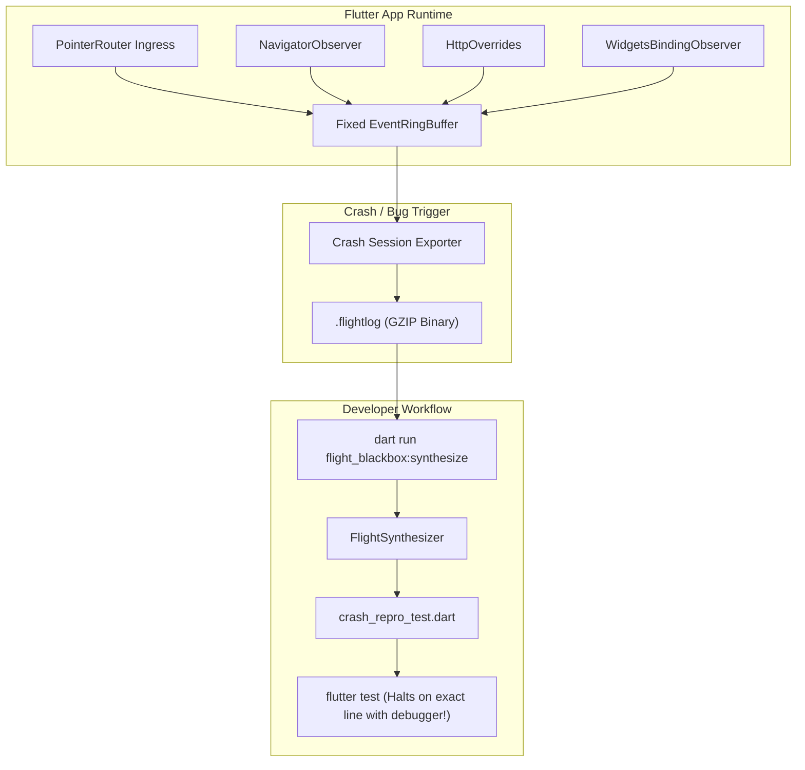

# flight_blackbox ✈️📦

**Deterministic in-app event-sourcing ring buffer and crash-to-`testWidgets` synthesizer for Flutter.**

---

## The Paradigm Shift

When an app crashes or experiences a race condition in QA or production, developers typically receive a stack trace:
```text
Null check operator used on a null value in _RenderFlex...
```
Or a video recording from a tester saying: *"It crashed when I tapped pay while navigating back."*

Developers typically spend **days** trying to manually recreate the exact gesture velocities, asynchronous timing, and network response payloads to reproduce the bug.

**`flight_blackbox` eliminates the reproduction cycle:**
1. Records user pointer events, route transitions, and HTTP calls into a fixed, zero-allocation circular ring buffer.
2. When a crash occurs (or QA triggers a report), it serializes the session into a compact, encrypted `.flightlog` or `.eflightlog`.
3. **The Synthesizer CLI** converts that recording into an executable `testWidgets` Dart test file.
4. Run `flutter test test/repros/crash_test.dart` and the bug reproduces with breakpoints right inside your IDE.

---

## Key Architectural Highlights

- **Engine-Level Pointer Interception & Semantic Resolution:** Taps directly into `GestureBinding.instance.pointerRouter.addGlobalRoute` and walks the render tree via `SemanticResolver` to generate resilient finders (`find.byKey`, `find.text`, `find.byType`) rather than fragile pixel coordinates.
- **Zero-Allocation Ring Buffer:** $O(1)$ enqueue/dequeue using pre-allocated circular memory slots. Zero heap garbage collection impact during high-frequency gesture tracking.
- **Keyboard & IME Input Tracking:** Intercepts `flutter/textinput` platform messages, mapping keystrokes to target inputs with `RedactionEngine` masking and generating clean `tester.enterText(...)` assertions.
- **Platform Channel Replay & `MissingPluginException` Immunity:** Captures all `MethodChannel` calls and automatically generates `PlatformChannelReplayBinding.installAll(...)` stubs in tests so third-party plugins (camera, biometric, bluetooth) never fail in CI headless test environments.
- **WebSocket Recording & In-Process Replay:** Automatically records bidirectional WebSocket frames and replays them deterministically via `FlightWebSocketReplayServer`.
- **Pure-Dart Authenticated Cryptography:** Full ChaCha20 quarter-round stream cipher + HMAC-SHA256 authenticated encryption engine (`.eflightlog`) with PBKDF2 key derivation. Zero external native dependencies.
- **Automatic DI Test Harness Scaffolding:** Detects your project's DI architecture (Riverpod, GetIt, Bloc, Provider) and generates complete `test/flight_harness.dart` scaffolding.
- **Sub-Pixel Noise Throttling:** Smart distance & delta filtering for `PointerMoveEvent` so finger drags don't overflow the memory buffer.
- **Enterprise-Grade PII Sanitizer:** Automatic regex and key-based scrubbing for credit cards, bearer tokens, passwords, and emails before anything hits the buffer.
- **Dual Replay Harness:** Standalone `FlightReplayServer` automatically mocks recorded HTTP calls during test execution with zero external network dependencies.
- **Pure Dart CLI:** `dart run flight_blackbox:synthesize` runs anywhere—including lightweight CI/CD agents—without requiring the Flutter GUI engine.

---

## Architecture Overview



---

## Getting Started

### 1. Add to `pubspec.yaml`

```yaml
dependencies:
  flight_blackbox: ^0.1.0
```

### 2. Initialize in `main.dart`

```dart
import 'package:flutter/material.dart';
import 'package:flight_blackbox/flight_blackbox.dart';

void main() {
  WidgetsFlutterBinding.ensureInitialized();

  // Start recording
  FlightRecorder.instance.start(
    config: FlightConfig(
      bufferCapacity: 1000,
      enablePointerRecording: true,
      enableNavigationRecording: true,
      enableHttpRecording: true,
      enableCrashRecording: true,
    ),
  );

  runApp(const MyApp());
}

class MyApp extends StatelessWidget {
  const MyApp({super.key});

  @override
  Widget build(BuildContext context) {
    return MaterialApp(
      navigatorObservers: [
        FlightRecorder.instance.navigatorObserver, // Tracks route pushes/pops
      ],
      builder: (context, child) {
        // Optional: Diagnostic floating pill for internal/staging builds
        return FlightRecorderOverlay(
          child: child ?? const SizedBox.shrink(),
        );
      },
      home: const HomeScreen(),
    );
  }
}
```

---

## Synthesizing a Test from a Crash Log

When a `.flightlog` or encrypted `.eflightlog` is exported (or caught by the automatic crash dumper):

```bash
# Standard synthesis
dart run flight_blackbox:synthesize -i crash.flightlog -o test/repros/crash_test.dart -w "const MyApp()"

# Synthesizing from an encrypted session with DI harness auto-detection
dart run flight_blackbox:synthesize \
  -i crash.eflightlog \
  -k "your-secure-passphrase" \
  -o test/repros/crash_test.dart \
  -w "const MyApp()" \
  -H auto
```

### CLI Options

| Flag | Abbr | Description | Default |
| :--- | :--- | :--- | :--- |
| `--input` | `-i` | Path to `.flightlog` or `.eflightlog` | **Required** |
| `--output` | `-o` | Destination path for generated Dart test | `test/repro_test.dart` |
| `--widget` | `-w` | Root application widget constructor | `const Placeholder()` |
| `--description` | `-d` | Test description inside `testWidgets` | `Reproduced Flight Session Test` |
| `--key` | `-k` | Decryption passphrase for `.eflightlog` | `null` |
| `--harness` | `-H` | Generates `test/flight_harness.dart` (`auto`, `riverpod`, `bloc`, `get_it`, `provider`) | `null` |

---

### Sample Synthesized Test with Semantic Resolution & Platform Stubs

```dart
// AUTO-GENERATED BY FLIGHT RECORDER
import 'package:flutter/material.dart';
import 'package:flutter_test/flutter_test.dart';
import 'package:flight_blackbox/flight_blackbox.dart';
import 'package:my_app/main.dart';

final List<ReplayFixture> _recordedFixtures = [
  ReplayFixture(
    method: 'GET',
    urlPattern: 'https://api.myapp.com/cart',
    statusCode: 200,
    responseBody: r'''{"items": [{"id": 42, "name": "Item"}]}''',
  ),
];

void main() {
  testWidgets('Reproduced Flight Session Test', (WidgetTester tester) async {
    // 1. Configure viewport & device metrics to match recording
    tester.view.physicalSize = const Size(1080.0, 2400.0);
    tester.view.devicePixelRatio = 2.62;
    addTearDown(tester.view.resetPhysicalSize);
    addTearDown(tester.view.resetDevicePixelRatio);

    // 2. Install deterministic HTTP replay server & platform stubs
    final replayServer = FlightReplayServer(fixtures: _recordedFixtures);
    replayServer.install();
    addTearDown(replayServer.uninstall);

    // 3. Pump application tree
    await tester.pumpWidget(const MyApp());
    await tester.pumpAndSettle();

    // 4. Deterministic interaction replay with semantic finders
    await tester.pump(const Duration(milliseconds: 140));
    await tester.tap(find.byKey(const Key('catalog_search_field')));
    await tester.pump(const Duration(milliseconds: 80));
    await tester.enterText(find.byKey(const Key('catalog_search_field')), 'Laptop');
    await tester.pumpAndSettle();
    
    // Tap button resolved by text
    await tester.tap(find.text('Add to Cart'));
    await tester.pump();
  });
}
```

Run it locally:
```bash
flutter test test/repros/crash_test.dart
```

---

## Security & PII Redaction

`flight_recorder` adopts a **safe-by-default posture**:
- Headers like `Authorization`, `Cookie`, `X-Api-Key` are automatically masked to `[REDACTED]`.
- JSON object keys containing `password`, `token`, `secret`, `credit_card`, `ssn`, `cvv` are recursively redacted.
- Strings are checked against Regex rules for credit cards, emails, and bearer tokens.

You can register custom redaction rules easily:
```dart
FlightRecorder.instance.start(
  config: FlightConfig(
    redactionEngine: RedactionEngine(
      rules: [
        RedactRule.emails(),
        RedactRule.creditCards(),
        RedactRule(
          name: 'phone_numbers',
          pattern: RegExp(r'\+?\d{10,14}'),
          replacement: '[PHONE_REDACTED]',
        ),
      ],
    ),
  ),
);
```

---

## Diagnostic Overlay

Wrap your app with `FlightRecorderOverlay` in staging or dogfood builds. A floating diagnostic button gives testers and developers instant access to:
- A live event stream showing recent pointer events, navigation history, and network calls.
- **Export `.flightlog`** to share directly on GitHub or Jira.
- **Copy Dart Test** to clipboard to immediately paste into your test suite.
